<div align="center">

# ArchTree

### Neural Architecture Search via Trie-Based Deduplication and Zero-Cost Proxies, with Hardware-Aware Coverage
#### An Empirical Study of LLM-Guided Warm-Start

*Never train an architecture twice, and train only the proposals that a label-free zero-cost gate ranks in the top 35%.*


-555555)


**[Paper](#-paper-and-supplementary-material)** · **[Highlights](#-highlights)** · **[Objectives](#-objectives-and-outcomes)** · **[Method](#-method)** · **[Data](#-benchmarks-and-data)** · **[Results](#-results)** · **[Statistics](#-statistical-evidence)** · **[Quick start](#-quick-start)** · **[Reproduce](#-reproducing-the-study)**

</div>

---

## 📌 Overview

Neural architecture search (NAS) is expensive because the only reliable way to know how good a network is,
is to train it. Sample-based searches waste much of that budget in two ways:

* **Repetition.** They train architectures they have already trained. In our runs an LLM generator spent
  55% of its evaluations on repeats at the largest budget, and a memory-less bandit spent 74%.
* **Futility.** They train proposals that a cheap check could have rejected.

**ArchTree-RMG** removes both. A prefix **trie** over architecture tokens makes a repeated evaluation
impossible by construction. It is searched with **R**ank-normalised UCB mixed with tournament **M**utation,
and a **label-free zero-cost G**ate lets only the top 35% of proposals reach real training. The gate uses
three training-free proxies and zero accuracy labels.

The study then asks, under a **fair compute budget (equal GPU-hours)** and with a full statistical toolkit,
which parts actually matter. It covers 3 benchmarks, 9 external baselines, 12 seeds plus 12 held-out seeds,
12,289 complete searches and 1,404 paired tests.

> **This is an empirical study, not a new state-of-the-art claim.** What carries over to other searches is
> the gate, the evaluation protocol and a closed-form criterion for when cost-aware gating helps.

---

## 📄 Paper and supplementary material

The study is written up as a journal manuscript (submitted to *Sādhanā – Academy Proceedings in Engineering
Sciences*, Springer / Indian Academy of Sciences; under review).

| File | Contents |
|---|---|
| [`paper/main.pdf`](paper/main.pdf) | manuscript: 20 pages, 17 figures, 8 tables, 1 algorithm |
| [`paper/supplementary/supp.pdf`](paper/supplementary/supp.pdf) | supplementary material: 26 pages, 43 tables (S1–S43), 16 figures (S1–S16) |
| [`paper/main.tex`](paper/main.tex), [`paper/supplementary/supp.tex`](paper/supplementary/supp.tex) | LaTeX sources (journal class `sadhana.cls` included) |
| [`paper/make_figures.py`](paper/make_figures.py) | draws every manuscript figure from the result CSVs |
| [`paper/supplementary/make_supp_tables.py`](paper/supplementary/make_supp_tables.py), [`make_supp_figures.py`](paper/supplementary/make_supp_figures.py) | write every supplementary table and figure from the result CSVs |

The supplement holds what the page limit left out: the detailed search loop, the status of the formal
statements, every per-cell result and paired test (fixed budget, equal GPU-hours, gate grid, ablations,
NAS-Bench-101, LLM studies, hardware), the seeds, the reproducibility checks and the data checksums. No number
in either document is typed by hand. The rebuild commands are under
[Reproducing the study](#-reproducing-the-study).

---

## ✨ Highlights

| | Finding | Evidence |
|---|---|---|
| 💰 | **The gate halves the cost of a search at equal accuracy.** 59–60% fewer real evaluations and **53% fewer GPU-hours** on NAS-Bench-201 (budget 200), with test accuracy +0.16 / +0.43 / +0.02 points | [Stage-wise development](#1-stage-wise-development-nas-bench-201) |
| ⚖️ | **No significant loss at equal GPU-hours.** 261 Holm-corrected comparisons against 13 arms on 3 benchmarks give **57 wins / 204 ties / 0 losses**. ArchTree-RMG is tied-best on NB201 and within the Nemenyi critical difference of the leader on every benchmark | [Equal GPU-hours](#4-equal-gpu-hours-the-fair-comparison) |
| 🔌 | **The gate is portable.** It raises the accuracy of 25 of 27 proposer–benchmark cells: ArchTree +0.38, RE +0.26, random +0.22, local search +0.19 points | [Transfer](#7-transfer-to-nas-bench-101-and-portability-of-the-gate) |
| 🔍 | **Zero-cost proxies are training-cost detectors in cell spaces** (Spearman ρ with training time 0.78 NB201, 0.63 NB101) **but not in a width space** (0.20 NATS-SSS) | [Why the gate works](#6-why-the-gate-works-proxies-as-cost-detectors) |
| 📐 | **A closed-form gate-cost criterion,** `r_PA·r_PD − r_DA`, predicted *before any search* that a cost penalty would hurt, on 7 of 7 benchmark–dataset pairs. Measured: 16 losses / 0 wins in 21 cells | [Gate-cost criterion](#5-the-gate-cost-criterion) |
| 🤖 | **An LLM prior speeds up only the start of the search.** It gets within 1 point of the best accuracy in the space after 5.0 vs 15.5 evaluations (C10) and 15.6 vs 30.8 (C100). Prompt controls point to general knowledge about operations rather than memorised benchmark tables; final accuracy never changes | [LLM prior](#9-what-does-the-llm-prior-add) |
| 🌳 | **The tree structure adds nothing beyond deduplication.** Trie vs flat bandit with a hash set: 0 of 12 cells differ | [Ablations](#8-ablations-what-the-parts-contribute) |

---

## 🎯 Objectives and outcomes

**Aim.** Make NAS cheaper by never evaluating the same architecture twice and by letting a label-free
zero-cost gate decide which proposals deserve a real evaluation. Then test, honestly and under fair compute,
whether an LLM prior and the tree structure add anything on top.

| ID | Objective | Outcome | Status |
|---|---|---|---|
| C1 | Compressed trie with O(L) deduplication | 0 repeated real evaluations in every ArchTree run (LLM-NAS 30% and a memory-less bandit 67% on average over budgets; 55% and 74% at budget 200) | ✅ met |
| C2 | UCB traversal of the trie | Rank-normalised reward fixes a reward-scale flaw; robust to C (0 of 78 tests significant). Regret: informal argument only | ✅ met (empirical) |
| C3 | Hierarchical weight inheritance | Implemented, but nothing is trained on tabular benchmarks, so it is simulated | ⚪ not claimed |
| C4 | Formal statements | T1 (O(L) insert) and T2 (no re-evaluation) hold. T4 (pruning keeps the optimum) is false as first stated, so pruning is presented as a heuristic | 🟡 partly met |
| C5 | Evaluation on standard benchmarks | NAS-Bench-201 (3 datasets), NAS-Bench-101 (TensorFlow-free reader), NATS-Bench SSS and HW-NAS-Bench | ✅ exceeded |
| C6 | TCR coverage metric | Implemented and reported; hardware coverage defined as HV/HV\* | ✅ minor |
| **C7** | **LLM warm-start prior** | 2–3× faster early convergence on CIFAR-10/100 (Holm-significant), none on ImageNet16-120, same final accuracy. Knowledge controls argue against memorisation and against a pure size heuristic | 🟡 partly met |
| **C8** | **Zero-cost proxy ensemble as a gate** | Label-free gate (τ 0.63–0.68) as good as a supervised one that costs 1,500 labels; 53% of GPU-hours saved; helps every proposer | ✅ **main contribution** |
| **C9** | **Hardware-aware search + TCR-H** | Device Pareto fronts barely overlap (Jaccard ≈ 0.13), yet a transferred front keeps ≈ 98% of the hypervolume; search ties NSGA-II-style and random (96/96) | 🟡 analysis only |
| new | Fair compute: equal GPU-hours | 1,128 runs, 14 arms, 3 benchmarks: 0 losses; tied-best / 2nd / 4th, inside the CD everywhere | ✅ met |
| new | Explain why proxy gates work | Cost-detector analysis plus a closed-form gate-cost criterion, validated on 7 pairs (sign right; size under-predicted) | ✅ **most novel result** |
| new | Does the tree structure itself help? | No: with deduplication, trie = flat UCB | ✅ answered (negative) |

Full goal history (original plan → final outcome): [`ReadMe/goalREADME.md`](ReadMe/goalREADME.md).

---

## 🧭 Method

### Overall workflow

<p align="center">
  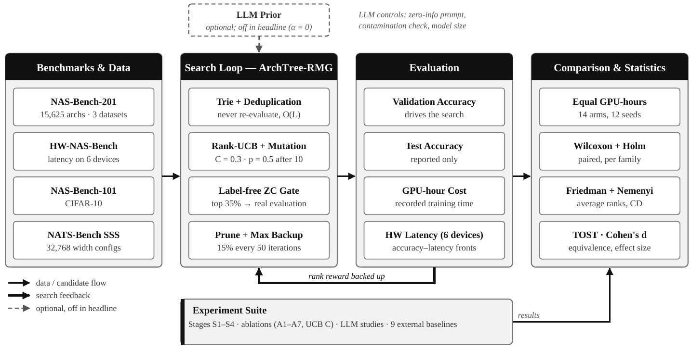
</p>

The four benchmarks provide look-up tables of accuracy, training time and latency. ArchTree-RMG generates
candidates, drops repeats and screens the rest with the gate. Only validation accuracy steers the search; test
accuracy is reported at the end. Every method gets the same GPU-hour budget and is compared with paired and
rank-based tests. The optional LLM prior (dashed box) is off in the headline system.

### The search loop

<p align="center">
  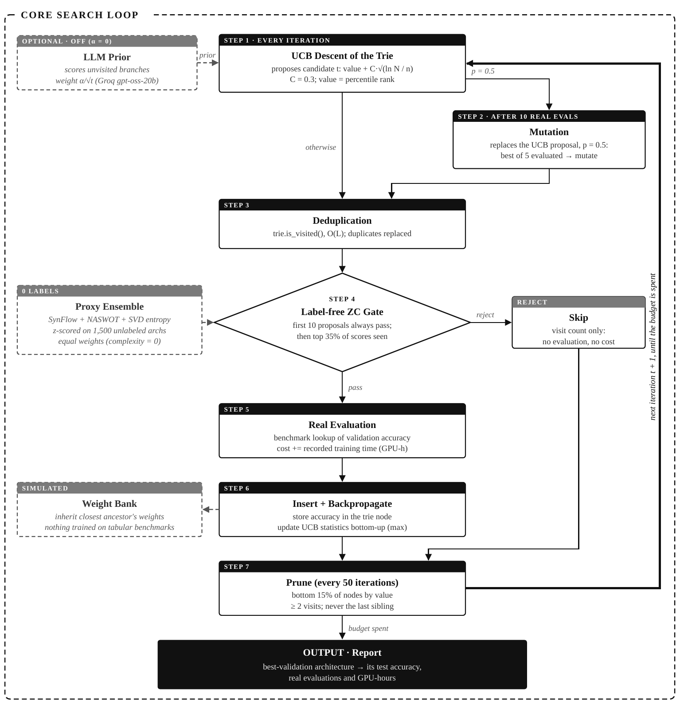
</p>

| Step | Block | What it does |
|---|---|---|
| 1 | **UCB descent of the trie** | At each node pick `argmax_c [ r̄(c) + C·√(ln N(p) / n(c)) ]`, with C = 0.3 and max backup. The value r̄ is the **percentile rank** of the subtree's best accuracy among all accuracies seen in the run, `r_t(a) = (1/t)·Σ 1[A(a_i) ≤ A(a)]`. The original design (ArchTree-base) used raw accuracy/100 with C = √2, which let the exploration bonus swamp all differences |
| 2 | **Mutation** | After 10 real evaluations, with p = 0.5 the proposal is replaced by a one-token mutation of the best of 5 random evaluated architectures (tournament, as in regularized evolution) |
| 3 | **Deduplication** | `trie.is_visited()` in O(L). A repeat or invalid proposal is replaced by a random unevaluated one. No architecture is ever trained twice, by construction |
| 4 | **Label-free gate** | `P(a) = ⅓[z(E) + z(S) + z(T)]`: SVD entropy, SynFlow and NASWOT on an untrained 32-channel proxy network, z-scored with statistics of 1,500 **unlabelled** architectures. After 10 warm-up proposals, `a_t` is evaluated only if `P(a_t) ≥ q₀.₆₅{P(a₁…a_t)}` (top 35% so far). About 0.28 s per proxy evaluation |
| 5 | **Real evaluation** | Benchmark lookup of the **validation** accuracy; cost += the recorded training time (GPU-hours) |
| 6 | **Insert + backpropagate** | Store the accuracy, update visit counts and max values bottom-up. The weight bank (inherit the ancestor's weights) is simulated on tabular benchmarks |
| 7 | **Prune** | Every 50 iterations mark the bottom 15% of internal nodes by value (≥ 2 visits, never the last live child). A heuristic, not a guarantee |
| – | **LLM prior** *(optional, off)* | `gpt-oss-20b` scores the unvisited operations of a prefix (JSON schema, 0–9); it orders never-visited children with weight `α/√t'` and is no longer queried once `α_t < 0.02` |
| out | **Report** | The best-validation architecture's **test** accuracy, real evaluations and GPU-hours |

**Naming used throughout:**

| Name | Meaning |
|---|---|
| **S1 · ArchTree-base** | trie + raw-reward UCB (C = √2, mean backup), no gate |
| **S2** | S1 + supervised zero-cost gate (weights fit on 1,500 labelled architectures) |
| **S3 · ArchTree-RM** | **R**ank-normalised UCB + **M**utation, no gate |
| **S4 · ArchTree-RMG** | S3 + label-free **G**ate: **the final system**, referred to simply as ArchTree |
| **ArchTree-HW** | latency-penalised trie search for HW-NAS-Bench (reward `A − 5·min(lat/50 ms, 1)`, no gate, no mutation) |

### Settings and the evidence for each

All settings were fixed before the final runs and are identical in every reported run (`config.yaml`).

| Choice | Evidence |
|---|---|
| Trie | no repeated evaluation by construction; a flat bandit wastes 73–74% |
| Rank reward | raw reward gives near-uniform descent; ArchTree-base is 0.63 pt worse on held-out seeds |
| Mutation p = 0.5 | carries most of the accuracy; mutation-only is level with ArchTree-RMG |
| C = 0.3, max backup | best of 14 settings; 0 of 78 differences significant |
| Gate q = 0.35 | smallest round rate that keeps all top-5% NB201 architectures |
| E + S + T, no labels | τ within 0.04 of the supervised ensemble; an explicit size term lowers recall |
| No cost penalty | criterion slope < 0 on 7/7 pairs; the penalty loses 16/21 cells |
| LLM prior off | faster start only; no final-accuracy gain |
| Pruning 15% | thresholds 0–35% are indistinguishable |
| Warm-up 10, tournament 5 | minimum sample for the quantile and the tournament |
| Seeds | 12 main + 12 held-out for design checks |

<p align="center">
  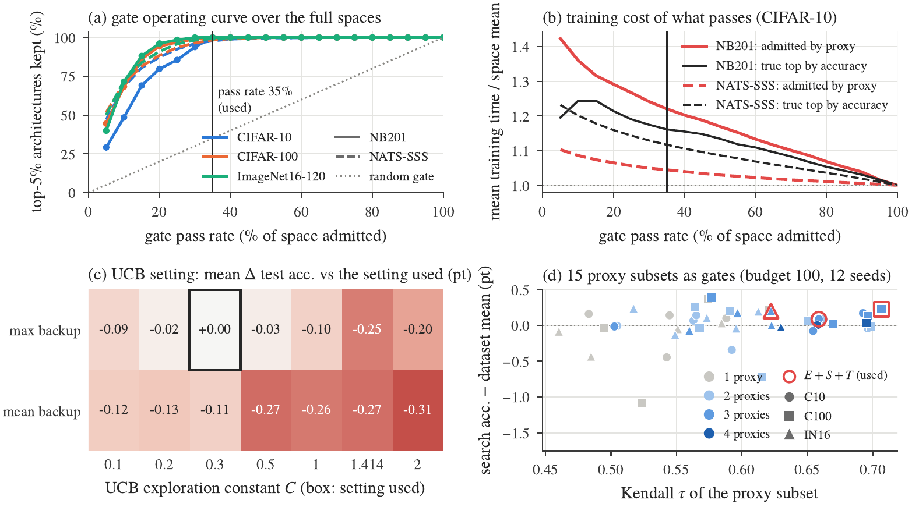<br/>
  <sub><b>Evidence for the settings.</b> (a) Share of the top-5% architectures kept by a static label-free gate that admits a fraction q of the space. (b) Training time of the admitted architectures relative to the space mean, compared with the truly best fraction. (c) UCB settings relative to the one used. (d) The 15 proxy subsets used as the gate.</sub>
</p>

---

## 🗂️ Benchmarks and data

All accuracies and training times are **looked up**, so nothing is trained during search. GPU-hours are the
recorded training times of the architectures a search actually evaluates. Search uses **validation**
accuracy; **test** accuracy is only reported.

| Benchmark | Search space | \|𝒜\| | Data | Epochs | Test mean ± s.d. | Best | Mean τ (h) | ρ(test, τ) |
|---|---|---:|---|---:|---|---:|---|---:|
| **NAS-Bench-201** | cell, 6 edges × 5 ops | 15,625 | CIFAR-10 | 200 | 87.06 ± 12.94 | 94.37 | 0.51 | 0.64 |
| | | | CIFAR-100 | 200 | 61.39 ± 12.17 | 73.51 | 1.02 | 0.65 |
| | | | ImageNet16-120 | 200 | 33.57 ± 9.51 | 47.31 | 3.08 | 0.62 |
| **NAS-Bench-101** | cell DAG ≤ 7 nodes | 423,624 | CIFAR-10 | 108 | 89.68 ± 5.80 | 94.32 | 0.54 | 0.34 |
| **NATS-Bench SSS** | 5 widths ∈ {8…64} | 32,768 | CIFAR-10 | 90 | 91.09 ± 1.27 | 93.65 | 0.11 | 0.60 |
| | | | CIFAR-100 | 90 | 62.64 ± 5.63 | 71.34 | 0.20 | 0.27 |
| | | | ImageNet16-120 | 90 | 37.09 ± 4.75 | 47.40 | 0.30 | 0.51 |
| **HW-NAS-Bench** | NB201 cells + measured latency | 15,625 × 6 | CIFAR-10 | – | – | – | – | – |

HW-NAS-Bench devices: edge GPU, Raspberry Pi 4, edge TPU, Pixel 3, Eyeriss and FPGA. Mean τ is the training
time of one architecture in GPU-hours; ρ is the Spearman correlation over the whole space.

<p align="center">
  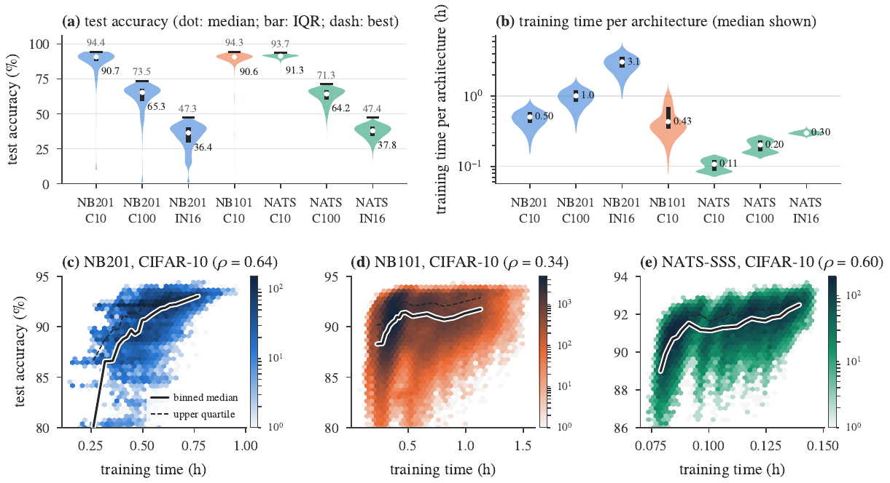<br/>
  <sub><b>The three search spaces as data.</b> (a) Test-accuracy distribution of every architecture. (b) Training time per architecture (log scale). (c–e) Joint density of training time and test accuracy on CIFAR-10. Accuracy rises with cost in all three spaces, which is why cost must be measured in GPU-hours, not in evaluations.</sub>
</p>

* **Why these three spaces.** NB201 is the main test bed. NB101 is a 27× larger cell space with weaker
  proxies, so it tests transfer. NATS-SSS fixes the cell and varies only widths, the natural stress test for
  "proxies detect cost".
* **Derived caches.** The raw files (about 6.5 GB) are converted once into small caches keyed by a canonical
  architecture code: NB201 4.9 MB, NB101 22 MB, NATS-SSS 12.8 MB, plus HW tables and exact Pareto fronts. The
  NB101 build refuses to finish unless all 423,624 module hashes are reproduced, without TensorFlow. Every
  file is pinned by SHA-256.
* Downloads, cache builds, checksums and licences: [`data/README.md`](data/README.md) ·
  HW-NAS-Bench: [`third_party/README.md`](third_party/README.md).

---

## 🧪 Experimental design

**Baselines (9 external, same seeds, all three NB201 datasets).**

| Family | Baselines |
|---|---|
| Random / evolutionary | random search · regularized evolution (RE) · RE + zero-cost warm-up (best of 1,000 proxy-scored architectures; closest prior work) |
| Local / policy / tree search | local search (LS) · ENAS-style · MCTS-style |
| Proxy-guided | ZiCo-style sampling · RZ-style zero-cost mutation walk |
| LLM generation | LLM-NAS (`gpt-oss-20b`, 8 architectures per call, best-so-far context) |

The baselines marked "-style" are re-implementations. The internal arms are: no gate, #params gate,
supervised gate, cost-penalised gates (λ = 0.25, 1), flat UCB with and without deduplication, and random or
NSGA-II-style search for hardware. **Every proposer was run behind every gate,** so the effect of the gate
can be separated from the effect of the proposer.

**Protocol.**

| Element | Choice |
|---|---|
| Budgets | NB201: 25 / 50 / 100 / 200 proposals · NB101: 50 / 100 / 200 / 400 |
| Seeds | 12 main `[42, 111, 123, 222, 333, 456, 789, 999, 1001, 2024, 31415, 27182]` + 12 held-out `[7, 13, 77, 101, 202, 303, 404, 505, 606, 707, 808, 909]` |
| Equal GPU-hours | every arm's history is cut at `H_k = k·τ̄`, with `Σ τ(a) ≤ H_k` and k ∈ {25, 50, 100} (τ̄ = mean training time of one architecture); 14 arms (10 on NB101) × 12 seeds = 1,128 runs |
| Cost | real evaluations **and** GPU-hours; proxy time charged (≤ 0.05% of an NB201 budget); supervised calibration labels counted |
| Pairing | every comparison is paired by seed |
| Determinism | 1 vs 3 parallel workers give identical results (252/252 runs) |

**Campaign: 12,289 complete, seed-paired searches.**

| Stage | Question answered | Runs |
|---|---|---:|
| Baselines | reference performance (9 methods) | 1,296 |
| S1 ArchTree-base | does a deduplicating tree search work? | 144 |
| S2 + supervised gate | how much does a proxy gate save? | 144 |
| S4 ArchTree-RMG | headline system | 144 |
| Proposer × gate grid | is the gate portable? (6 proposers × 4 gates) | 3,456 |
| Held-out design ablation | which design change matters? (new seeds) | 720 |
| Trie vs flat bandit (A7) | hierarchy or deduplication? | 432 |
| Toggle ablations (A1–A6) | LLM, gate, inheritance, α, pruning, budget | 792 |
| UCB sensitivity | C and backup rule | 1,008 |
| Proxy subsets | which proxies in the gate? | 612 |
| LLM studies | speed, α sweep, model size | 973 |
| NAS-Bench-101 | transfer to a larger space | 576 |
| Equal GPU-hours | fair-cost comparison, 3 benchmarks | 1,128 |
| Hardware (HW-NAS-Bench) | accuracy–latency search | 864 |
| **Total** | | **12,289** |

---

## 📊 Results

*Test accuracy (%) of the best-validation architecture, mean of 12 seeds, unless stated.*

### 1. Stage-wise development (NAS-Bench-201)

<p align="center">
  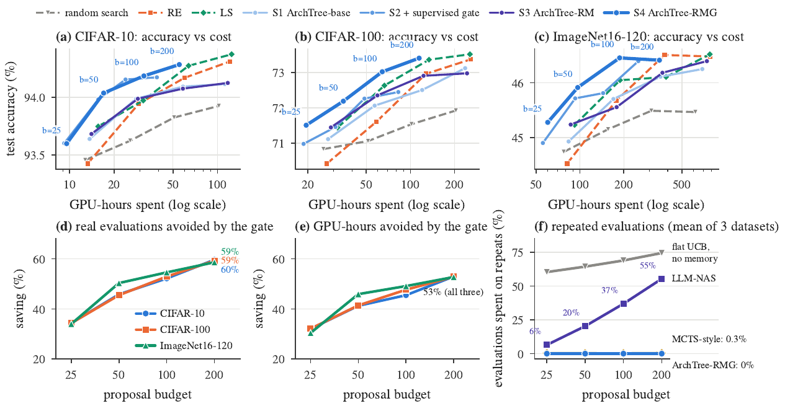<br/>
  <sub>(a–c) Test accuracy vs GPU-hours, one marker per budget; upper-left is better. (d, e) Real evaluations and GPU-hours avoided by the label-free gate. (f) Share of evaluations spent on repeats.</sub>
</p>

* **S1** (deduplicating trie) already beats random search, but stays below RE and LS.
* **S2** (supervised gate) cuts GPU-hours by 64–65%, but loses 0.67 points on CIFAR-100: a weak proposer
  fed with fewer evaluations finds fewer good regions.
* **S3** (rank reward + mutation) fixes the proposer, but without a gate it spends as much as RE.
* **S4 = ArchTree-RMG** combines both: 94.28 / 73.40 / 46.41 with 81–83 real evaluations and 47% of the
  GPU-hours of S3. It traces the upper-left boundary in all three panels. RE and LS come within −0.03 to
  +0.11 points only by spending **2.2–2.3× the GPU-hours**.
* The gate's savings grow with budget, reaching **59–60% of evaluations and 53% of GPU-hours at budget 200**.

### 2. Comparison with baselines at a fixed budget

NAS-Bench-201, budget 200 proposals (mean ± s.d. over 12 seeds):

| Method | Real evals | GPU-h (C10 / C100 / IN16) | CIFAR-10 | CIFAR-100 | ImageNet16-120 |
|---|---:|---|---|---|---|
| Random search | 200 | 102 / 204 / 619 | 93.92 ± 0.21 | 71.92 ± 0.81 | 45.47 ± 0.80 |
| MCTS-style | 200 | 103 / 207 / 630 | 93.89 ± 0.20 | 71.94 ± 0.87 | 45.44 ± 0.65 |
| ENAS-style | 200 | 115 / 236 / 717 | 94.09 ± 0.26 | 72.59 ± 0.81 | 46.16 ± 0.36 |
| LLM-NAS (`gpt-oss-20b`) | 200 | 140 / 274 / 825 | 94.28 ± 0.08 | 72.14 ± 0.43 | 45.37 ± 0.36 |
| ZiCo-style | 200 + proxy | 138 / 275 / 835 | 94.29 ± 0.12 | 72.97 ± 0.43 | 46.28 ± 0.57 |
| RZ-style ZC walk | 200 + proxy | 149 / 298 / 906 | 94.33 ± 0.07 | 73.39 ± 0.19 | 46.32 ± 0.18 |
| Regularized evolution | 200 | 121 / 258 / 782 | 94.31 ± 0.13 | 73.37 ± 0.21 | 46.48 ± 0.17 |
| RE + ZC warm-up | 200 + proxy | 125 / 263 / 820 | 94.28 ± 0.19 | 73.36 ± 0.23 | 46.34 ± 0.36 |
| Local search | 200 | 124 / 254 / 777 | **94.37 ± 0.00** | **73.51 ± 0.00** | **46.52 ± 0.29** |
| *S1 ArchTree-base* | 200 | 112 / 236 / 690 | 94.11 | 73.12 | 46.25 |
| *S2 S1 + supervised gate* | 62–65 | 39 / 83 / 252 | 94.17 | 72.45 | 46.39 |
| *S3 ArchTree-RM (no gate)* | 200 | 117 / 243 / 742 | 94.12 | 72.97 | 46.39 |
| *ArchTree-RM + supervised gate (1,500 labels)* | 76–81 | 54 / 112 / 348 | 94.26 | 73.27 | 46.43 |
| **S4 ArchTree-RMG (ours)** | **81–83** | **55 / 115 / 351** | 94.28 ± 0.13 | 73.40 ± 0.20 | 46.41 ± 0.18 |
| *Best architecture in the space (by validation)* | – | – | 94.37 | 73.51 | 46.20 |

<p align="center">
  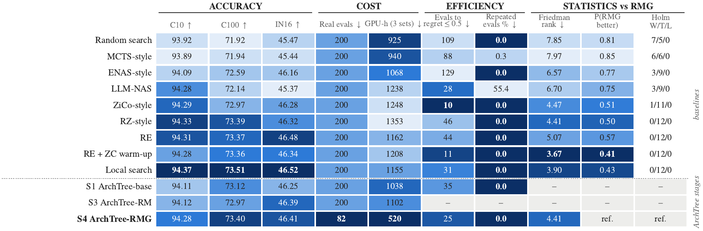<br/>
  <sub><b>Method scorecard</b> (NB201, budget 200, 12 seeds). Shading ranks methods within each column (darker = better). ArchTree-RMG leads on cost: <b>82 real evaluations and 520 GPU-hours</b> over the three datasets, 41% of the evaluations and 38–56% of the GPU-hours of the baselines. LS and RE + ZC warm-up lead on accuracy and rank.</sub>
</p>

* **Paired tests vs the 9 baselines** (3 datasets × 4 budgets = 108; Holm within each baseline):
  **20 wins / 88 ties / 0 losses.** The wins are against random (7), MCTS-style (6), ENAS-style (3),
  LLM-NAS (3) and ZiCo-style (1).
  * Uncorrected: 32 wins / 6 losses. Three of the losses are against RE + ZC warm-up at small budgets
    (a weakness of the 10 unfiltered warm-up proposals at budget 25).
  * Holm over all 108 jointly: every comparison is a tie, also when each baseline gets at least
    ArchTree's number of real evaluations.
* **Friedman ranking** (10 methods, 144 blocks, CD = 1.13): RE + warm-up 3.67, LS 3.90,
  **ArchTree-RMG 4.41**, within the CD of both while using about 40% of their evaluations.

### 3. Convergence

<p align="center">
  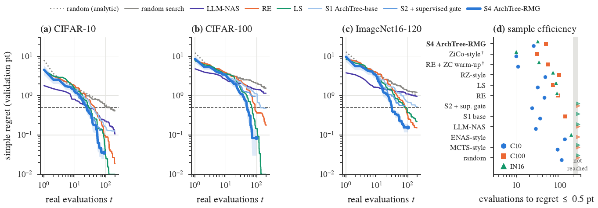<br/>
  <sub>Simple regret vs real evaluations (budget 200). (d) Real evaluations until the mean regret first falls to 0.5 points.</sub>
</p>

ArchTree-RMG comes within **0.5 points of the optimum after 25 / 48 / 31 real evaluations**, against
44 / 88 / 85 for RE and 31 / 69 / 81 for LS. Only the two methods that pre-screen 1,000 proxy-scored
candidates (ZiCo-style, RE + ZC warm-up) get there sooner, which again points to proxies as a filter.

### 4. Equal GPU-hours: the fair comparison

<p align="center">
  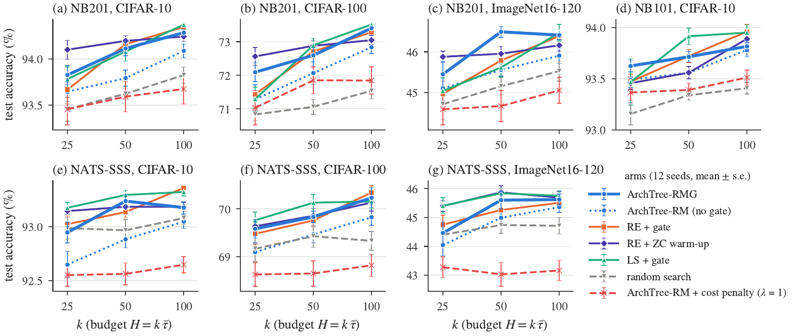<br/>
  <sub>Test accuracy within an equal GPU-hour budget H = k·τ̄ (mean ± s.e., 12 seeds). Solid: label-free gate (or ZC warm-up); dotted / dashed: ungated or cost-penalised. The gate lifts every proposer; penalising cost lowers accuracy on all seven benchmark–dataset pairs.</sub>
</p>

**ArchTree-RMG vs every arm** (Wilcoxon, Holm within each arm over its cells; up to 21 cells = 7 benchmark–dataset pairs × 3 budgets, 18 for arms not run on NB101):

| vs | Mean Δ (points) | Wins / ties / losses |
|---|---:|---|
| random + cost penalty (λ = 1) | +1.36 | 15 / 3 / 0 |
| ArchTree-RM + cost penalty (λ = 1) | +1.01 | 16 / 5 / 0 |
| random, no gate | +0.67 | 10 / 11 / 0 |
| random + cost penalty (λ = 0.25) | +0.51 | 6 / 12 / 0 |
| random + same gate | +0.49 | 6 / 12 / 0 |
| ArchTree-RM, no gate | +0.38 | 2 / 19 / 0 |
| RE, no gate | +0.36 | 1 / 20 / 0 |
| ArchTree-RM + cost penalty (λ = 0.25) | +0.16 | 0 / 18 / 0 |
| LS, no gate | +0.16 | 0 / 21 / 0 |
| ArchTree-RM + #params gate | +0.08 | 1 / 20 / 0 |
| RE + same gate · LS + same gate · RE + ZC warm-up | +0.10 · −0.03 · −0.07 | 0 / 21 / 0 each |
| **Total (261 tests)** | | **57 / 204 / 0** |

<p align="center">
  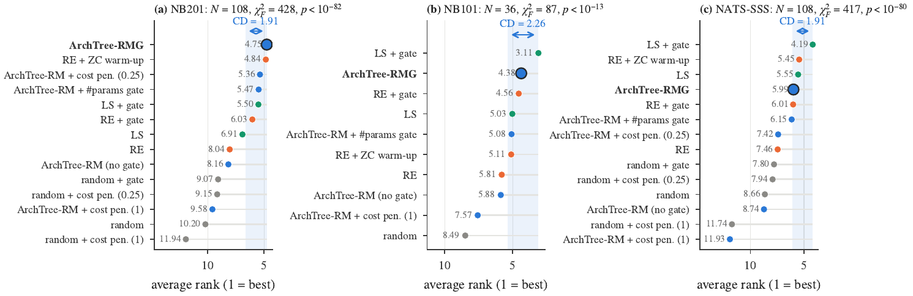<br/>
  <sub>Average Friedman rank at equal GPU-hours; the shaded band is the Nemenyi critical difference from the best arm.</sub>
</p>

| Benchmark | Arms | Blocks | Friedman p | CD | ArchTree-RMG | Leader |
|---|---:|---:|---|---:|---|---|
| NAS-Bench-201 | 14 | 108 | 3·10⁻⁸³ | 1.91 | **4.75 (tied-best)** | ≈ RE + ZC warm-up 4.84 |
| NAS-Bench-101 | 10 | 36 | 8·10⁻¹⁵ | 2.26 | 4.38 (2nd, within CD) | LS + gate 3.11 |
| NATS-Bench SSS | 14 | 108 | 6·10⁻⁸¹ | 1.91 | 5.99 (4th, within CD) | LS + gate 4.19 |

Under the same label-free gate at a fixed budget, ArchTree-RMG **matches RE in all 12 NB201 cells with
19–23% fewer GPU-hours** (55 / 115 / 351 vs 72 / 146 / 434), and has **0 losses in 240 same-gate
comparisons** (5 proposers × 4 gates).

### 5. The gate-cost criterion

Proxies prefer larger networks, which take longer to train. The obvious fix is to penalise predicted cost D
(`log(1 + #params)`) in the gate: `S_λ = z(P) − λ·z(D)`. With normal scores of accuracy A, proxy P and cost D
treated as jointly Gaussian (a Gaussian copula):

```
ρ(S_λ, A) = (r_PA − λ·r_DA) / √(1 + λ² − 2λ·r_PD)

∂ρ/∂λ |λ=0  =  r_PA · r_PD − r_DA
```

**A small penalty can only help if `r_DA < r_PA·r_PD`.** All three correlations can be estimated on a sample
of architectures **before any search is run**.

| Benchmark | Data | r_PA | r_PD | r_DA | Slope | Prediction | Measured (λ = 1, Holm) |
|---|---|---:|---:|---:|---:|---|---|
| NB201 | C10 | 0.83 | 0.79 | 0.69 | −0.04 | hurts | 3 L / 0 T |
| NB201 | C100 | 0.86 | 0.79 | 0.72 | −0.04 | hurts | 1 L / 2 T |
| NB201 | IN16 | 0.82 | 0.79 | 0.66 | −0.02 | hurts | 2 L / 1 T |
| NB101 | C10 | 0.47 | 0.82 | 0.44 | −0.05 | hurts | 1 L / 2 T |
| NATS-SSS | C10 | 0.74 | 0.67 | 0.89 | −0.39 | hurts | 3 L / 0 T |
| NATS-SSS | C100 | 0.84 | 0.67 | 0.75 | −0.19 | hurts | 3 L / 0 T |
| NATS-SSS | IN16 | 0.83 | 0.67 | 0.85 | −0.29 | hurts | 3 L / 0 T |

<p align="center">
  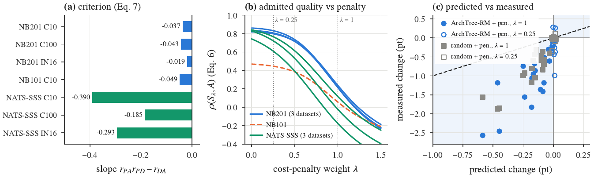<br/>
  <sub>(a) Criterion slope per pair. (b) ρ(S_λ, A) as a function of λ. (c) Predicted vs measured change in test accuracy from a cost-penalised gate.</sub>
</p>

**Result:** the slope is negative on all 7 pairs. With λ = 1 ArchTree loses to its own unpenalised gate in
**16 of 21 cells without a single win**, and the change is negative in all 21. Predicted and measured
changes agree in sign in 72% (ArchTree) and 69% (random) of cells, with Spearman +0.78 / +0.86. The copula
reproduces the unpenalised level closely (predicted 93.89 / 71.96 / 45.67 vs measured 93.92 / 71.92 / 45.45),
but **under-predicts the size of the losses several-fold, so only the sign and the ranking are claimed.**

**Practitioner's recipe:** estimate r_PA, r_PD and r_DA on a few hundred architectures. If
`r_PA·r_PD − r_DA < 0`, use the proxy gate **without** a cost penalty.

### 6. Why the gate works: proxies as cost detectors

<p align="center">
  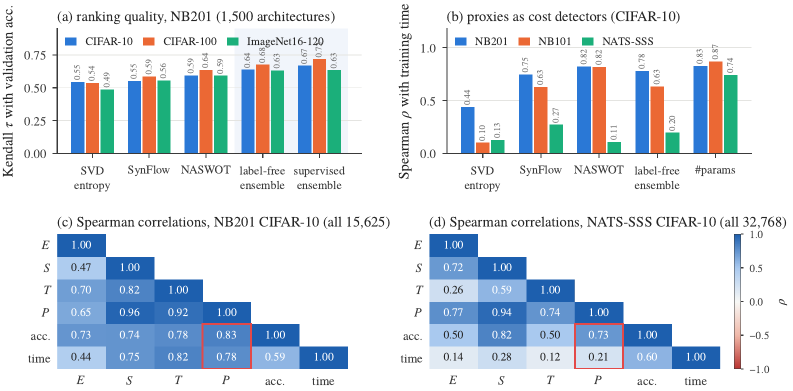<br/>
  <sub>(a) Kendall τ of each proxy with validation accuracy (1,500 NB201 architectures). (b) Spearman ρ between proxy score and training time. (c, d) Correlations over the complete spaces.</sub>
</p>

| Proxy (NB201, Kendall τ with validation accuracy) | CIFAR-10 | CIFAR-100 | ImageNet16-120 |
|---|---:|---:|---:|
| SVD entropy (E) | 0.55 | 0.54 | 0.49 |
| SynFlow (S) | 0.55 | 0.59 | 0.56 |
| NASWOT (T) | 0.59 | 0.64 | 0.59 |
| Supervised ensemble (1,500 labels) | 0.67 | 0.72 | 0.63 |
| **Label-free ensemble (0 labels, used)** | **0.64** | **0.68** | **0.63** |

* **Cell spaces:** the label-free score correlates with training time almost as strongly as #params does
  (ρ = 0.78 NB201, 0.63 NB101). The admitted 35% of NB201 train 1.22× the mean, but the truly best 35% train
  1.16–1.18× the mean, because accuracy itself rises with size. Only **3–5% of the extra cost is wasted.**
* **NB101:** the admitted 35% train 1.35× the mean vs 1.14× for the truly best, which is why the GPU-hour
  advantage over RE shrinks there.
* **Width space (NATS-SSS):** the ensemble is barely cost-related (ρ = 0.20–0.21, while #params is 0.68–0.74),
  and the admitted set is even cheaper than the true top set.
* Proxy quality on 2,000-architecture samples: NB101 τ = 0.33 (label-free) / 0.50 (supervised); NATS-SSS 0.53–0.63.

### 7. Transfer to NAS-Bench-101 and portability of the gate

<p align="center">
  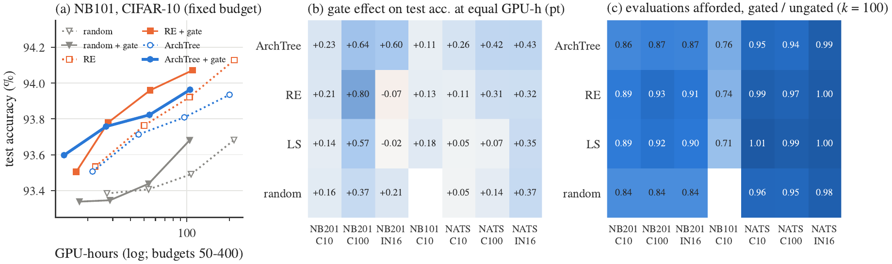<br/>
  <sub>(a) NB101 accuracy vs GPU-hours with (solid) and without (dotted) the gate. (b) Change in accuracy at equal GPU-hours when the gate is added to each proposer. (c) Ratio of real evaluations within H₁₀₀ with and without the gate.</sub>
</p>

* **NB101 (576 runs):** the gate still cuts real evaluations by **59%** and GPU-hours by **47%** at budget
  400 with no loss of accuracy. ArchTree beats random in **14 of 16** cells (2 ties). It ties RE in 15 and
  loses 1 (#params gate, budget 100, −0.31). At budget 400: ArchTree 93.96, RE 94.07, random 93.68.
* **Portability:** adding the gate raises accuracy in **25 of 27** proposer–benchmark cells. The two exceptions
  (−0.07, −0.02) are within noise. In cell spaces the gate buys 71–93% as many, larger architectures; on
  NATS-SSS 94–101% as many.

### 8. Ablations: what the parts contribute

<p align="center">
  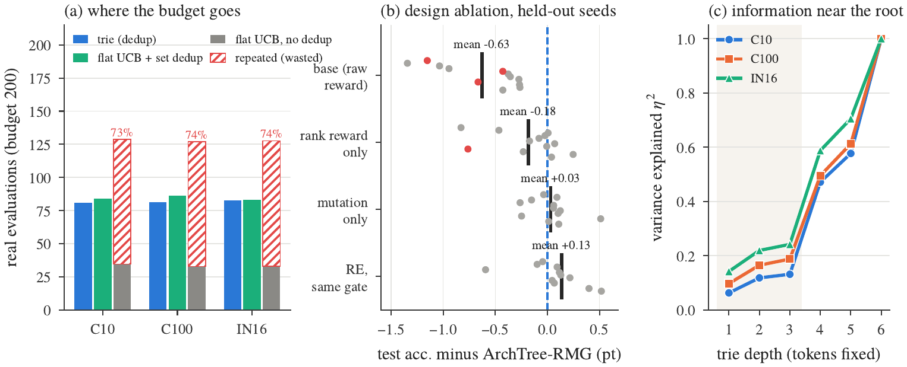<br/>
  <sub>(a) Real evaluations at budget 200 for the trie vs a flat per-position UCB, with and without deduplication (hatched = repeats). (b) Held-out-seed design ablation. (c) Share of accuracy variance explained by the first d tokens.</sub>
</p>

| Study | Result |
|---|---|
| **Trie vs flat bandit (A7)** | Without memory the flat bandit spends **73–74%** of its evaluations on repeats; the trie beats it in 3/12 cells (1 after Holm, +0.53). With a hash set added: **+0.06, 0/12**. The gain is deduplication, not hierarchy |
| Why the hierarchy does not help | The first 1–3 tokens explain only **6–24%** of accuracy variance (η²), rising to 47–59% at depth 4, so statistics near the root carry little information |
| **Design changes on 12 held-out seeds** | ArchTree-base −0.63 (3/12 significantly worse) · rank reward alone −0.18 · mutation alone +0.03 · RE + same gate +0.13 (ties). Accuracy comes mainly from mutation; the trie and the gate reduce what it costs |
| UCB C ∈ {0.1 … 2} × {mean, max} | 0 of 78 differences significant |
| Proxy subsets (15) | 2 of 48 tests significant (SVD entropy alone is worse) |
| Pruning 0–35% | within the seed-to-seed spread |

### 9. What does the LLM prior add?

<p align="center">
  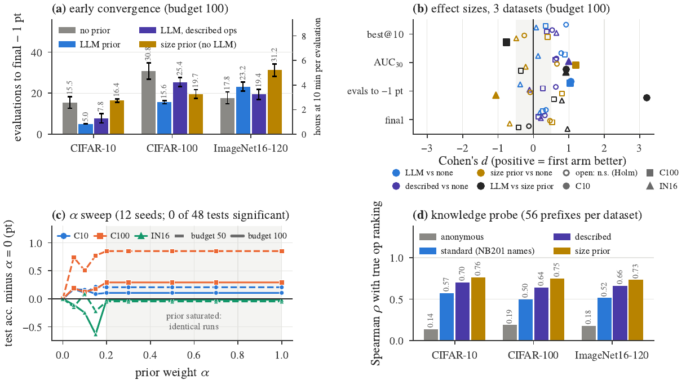<br/>
  <sub>(a) Evaluations to within 1 point of the best accuracy in the space (budget 100). (b) Cohen's d of four comparisons on four metrics. (c) α sweep. (d) Operation-ranking quality under four prompts / priors.</sub>
</p>

**Speed (budget 100, real evaluations needed to get within 1 point of the best validation accuracy in the space; a seed that never gets there counts at the end of its run):**

| | CIFAR-10 | CIFAR-100 | ImageNet16-120 |
|---|---|---|---|
| LLM prior / size prior / described prompt / off | **5.0** / 16.4 / 7.8 / 15.5 | **15.6** / 19.7 / 25.4 / 30.8 | 23.2 / 31.2 / 19.4 / **17.8** |
| LLM vs off | p_Holm = 0.047, d ≈ 1.0 | p_Holm = 0.047 | n.s. |
| Final accuracy | tie | tie | tie |

**What the model knows** (Spearman ρ of the predicted op ranking with the true NB201 ranking; 0 = chance):

| Prompt / prior | CIFAR-10 | CIFAR-100 | ImageNet16-120 |
|---|---:|---:|---:|
| anonymous (op names hidden and scrambled) | 0.14 | 0.19 | 0.18 |
| standard (NB201 op names) | 0.57 | 0.50 | 0.52 |
| **described** (what each op does, no benchmark names) | **0.70** | **0.64** | **0.66** |
| size prior (no LLM) | 0.76 | 0.75 | 0.73 |

* Plain-word descriptions beat the benchmark's own names, which **argues against recall of memorised tables**.
* The size prior ranks single ops best but **searches worse**: no faster than no prior on C10 and
  significantly *slower* on IN16 (+13.5 evaluations, p_Holm = 0.018). The LLM prior beats it on C10
  (p_Holm = 0.003, d = 4.0). The LLM contributes more than "bigger is better", but only at the start.
* At 10 min per evaluation the speed-up is 0.8 h instead of 2.6 h on C10. The model's own response time is at
  most 23 s per run.
* **α sweep:** 17 of 24 settings favour the prior, but none is significant after Holm (48 tests, of which 24 are distinct because all runs with α ≥ 0.2 coincide).
  `gpt-oss-120b` ranks slightly better (ρ 0.61 vs 0.60) but does not search better.

### 10. Hardware-aware search (HW-NAS-Bench)

<p align="center">
  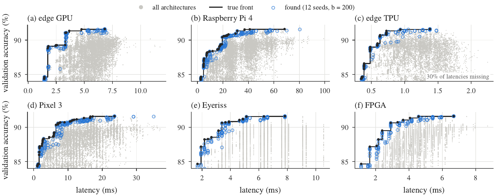<br/>
  <sub>Accuracy–latency trade-off on six devices (CIFAR-10). Grey: every architecture; black: true Pareto front; blue: fronts found by ArchTree-HW at budget 200.</sub>
</p>

| Device | HV ×10³ (ArchTree-HW / random / NSGA-II) | IGD (AT / Rnd / NSGA) | \|F\| found | \|F\*\| true | HV / HV\* |
|---|---|---|---:|---:|---:|
| Edge GPU | 91.35 / 91.06 / 91.18 | 0.22 / 0.38 / 0.17 | 12.6 | 24 | 0.995 |
| Raspberry Pi 4 | 91.00 / 90.88 / 91.16 | 2.04 / 1.31 / 1.78 | 18.4 | 48 | 0.991 |
| Edge TPU | 91.38 / 91.16 / 91.40 | 0.22 / 0.26 / 0.15 | 13.3 | 43 | 0.991 |
| Pixel 3 | 91.24 / 91.05 / 91.25 | 0.69 / 0.80 / 1.44 | 18.0 | 55 | 0.990 |
| Eyeriss | 91.33 / 91.03 / 91.26 | 0.51 / 0.64 / 0.34 | 11.0 | 17 | 0.971 |
| FPGA | 91.40 / 91.07 / 91.30 | 0.55 / 0.64 / 0.35 | 11.1 | 11 | 0.961 |

<p align="center">
  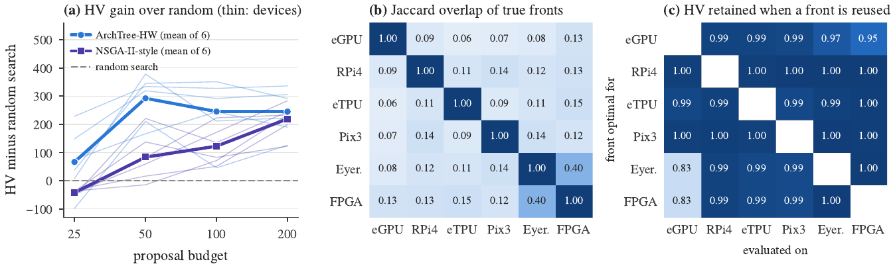<br/>
  <sub>(a) HV gain over random search. (b) Jaccard overlap of the true device fronts. (c) Hypervolume retained when another device's front is used.</sub>
</p>

* Found fronts reach **96–99.5% of the attainable hypervolume** at budget 200 (85–94% at budget 25), but all
  **96 HV/IGD comparisons are ties** after Holm.
* Device fronts **barely overlap** (mean Jaccard 0.13, at most 0.40). **Only 1 of 15,625** architectures is
  Pareto-optimal on all six devices.
* Yet a front optimal for one device keeps **98% of the hypervolume** on another (worst case 83%; normalised
  IGD 0.08 on average). A front found for one device is a good starting point for another.

---

## 📈 Statistical evidence

### Methods

| Method | What it answers | Details |
|---|---|---|
| **Wilcoxon signed-rank** (paired by seed) | is A different from B? | two-sided, per dataset × budget cell, n = 12 |
| **Holm–Bonferroni** | family-wise error control | within each comparison family; a win/loss counts only if p_Holm < 0.05 |
| **Cohen's d** (paired) | how large is the effect? | mean of paired differences / their s.d. |
| **Friedman + Nemenyi CD** | do all methods perform alike, and which are indistinguishable from the best? | blocks = dataset × budget × seed; CD = q_α·√(k(k+1)/6N) (Demšar 2006) |
| **TOST equivalence** | are two methods equal within ±δ? | two one-sided paired tests, δ = 0.5 and 0.25 points, Holm |
| **Probability of improvement** | how often does ArchTree-RMG win a paired run? | ties = ½; stratified bootstrap 95% CI, 2,000 resamples (Agarwal et al. 2021) |
| **Kendall τ / Spearman ρ** | proxy quality; cost detection; LLM ranking quality | 1,500–2,000 architectures or whole spaces |
| **Gaussian-copula criterion** | does a cost penalty help? | slope `r_PA·r_PD − r_DA`; Monte-Carlo of gated random search |
| **HV, IGD, Jaccard, HV/HV\*** | multi-objective quality, front overlap, hardware coverage | against the exact Pareto fronts |
| **Pseudo-replication guard** | is there seed-to-seed variation to test? | paired differences that are constant across seeds are not tested |

### All 1,404 paired tests

| Family | Tests | p < 0.05 (raw) | Holm-significant | Direction |
|---|---:|---:|---:|---|
| Fixed budget vs 9 baselines | 108 | 38 | 20 | 20 RMG wins |
| Same gate, 5 other proposers | 240 | 100 | 47 | 47 ArchTree wins |
| Equal GPU-hours, 3 benchmarks | 261 | 96 | 57 | 57 RMG wins |
| NB101, same gate | 32 | 16 | 15 | 14 wins, 1 loss (RE) |
| NB101, equal evaluations | 36 | 13 | 11 | 11 ArchTree wins |
| Held-out design ablation | 48 | 10 | 4 | all favour RMG |
| Trie vs flat bandit | 24 | 3 | 1 | trie better |
| Proxy subsets | 48 | 6 | 2 | SVD entropy alone worse |
| UCB C and backup | 78 | 9 | 0 | – |
| α sweep | 48 | 11 | 0 | – |
| LLM convergence (12 metrics) | 360 | 149 | 109 | early-search metrics only |
| LLM knowledge probe | 21 | 21 | 21 | all priors above chance |
| LLM model size | 4 | 1 | 0 | – |
| Hardware HV / IGD | 96 | 22 | 0 | – |
| **Total** | **1,404** | **495** | **287** | |

**Of the 677 tests comparing ArchTree-RMG with another search method, 149 are significant wins after Holm
and 1 is a loss.** The four sensitivity families (270 tests) give only two significant results, which
supports the robustness claims. The LLM families are significant only on early-search metrics, never on final
accuracy. Friedman rejects equal performance in every comparison (p < 10⁻⁷).

<p align="center">
  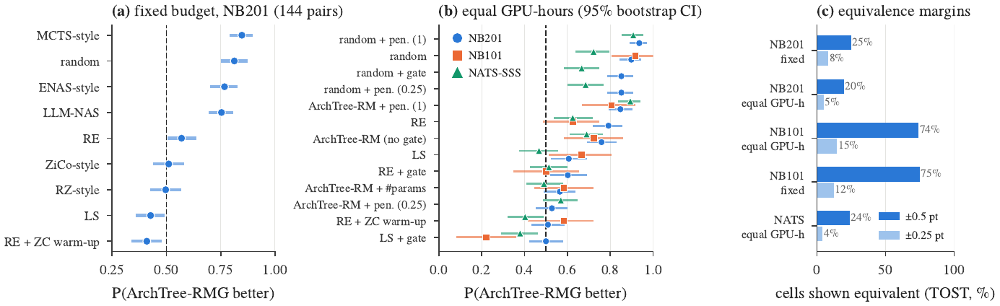<br/>
  <sub>P(ArchTree-RMG better) with stratified-bootstrap 95% CIs: (a) vs the nine baselines at a fixed budget; (b) vs every arm at equal GPU-hours. (c) Share of cells where TOST establishes equivalence.</sub>
</p>

* ArchTree-RMG wins **75–85% of paired runs** against MCTS-style, random, ENAS-style and LLM-NAS. It is close
  to 0.5 against RE, ZiCo-style and RZ-style. It is slightly below 0.5 against LS (0.43) and RE + ZC warm-up
  (0.41), which win a few more runs at a fixed budget, never significantly, and at about 2.3× the GPU-hours.
* At equal GPU-hours, LS + gate is the stronger arm on NB101 (0.22) and NATS-SSS (0.38).
* **TOST:** equivalence within ±0.5 points holds in 20–25% of NB201 and NATS-SSS cells and about 75% of NB101
  cells (≤ 15% within ±0.25). "No significant difference" therefore means **"within a few tenths of a
  point"**, not "identical".

---

## ⚠️ Limitations and threats to validity

* **Tabular benchmarks only.** Nothing is trained: GPU-hours are recorded training times, and weight
  inheritance is simulated. Image classification on small images only.
* **Not the best search everywhere.** Local search with the same gate is stronger on NB101 and NATS-SSS, and
  RE + ZC warm-up is better at budget 25. The portable contribution is the gate.
* **LLM prior.** Faster start on CIFAR-10/100 only, no final-accuracy gain, NB201-specific prompt. The model
  may have seen NAS-Bench-201 in pre-training: the described-prompt control argues against simple recall but
  cannot exclude all exposure.
* **Hardware-aware search** ties simpler multi-objective baselines. About 30% of edge-TPU latencies are missing
  in HW-NAS-Bench.
* **Proxies** always see CIFAR-10 images, also for CIFAR-100 and ImageNet16-120. NATS-SSS uses a proxy-size network.
* **Statistics.** 12 seeds resolve a few tenths of a point but rarely prove equivalence within ±0.5. Holm
  correction favours ties, so raw and corrected outcomes, effect sizes, bootstrap probabilities and TOST are
  reported side by side.
* **Gate-cost model.** It models gated *random* search and predicts sign and ranking, not magnitude.
* **Design selection.** The final design was chosen on the main seeds; the held-out-seed ablation is the
  unbiased test. "-style" baselines are re-implementations. 5 of 1,128 equal-GPU-hour runs ran out of
  proposals just before their budget and are kept, flagged.

---

## 🚀 Quick start

**Tested on:** Windows 11 · Python 3.10.9 · PyTorch 2.5.1 + CUDA 12.4 · NVIDIA RTX 2050 (4 GB). A CUDA GPU is
needed only for the zero-cost proxies.

```powershell
git clone https://github.com/Imaadhajwane/Arch-Tree-LLM.git archtree-llm
cd archtree-llm
Set-ExecutionPolicy -Scope Process -ExecutionPolicy RemoteSigned

# one command: GPU torch (cu124) + requirements + checks + preflight
.\setup_env.ps1                  # or: .\setup_env.ps1 -Cuda cu121   |   .\setup_env.ps1 -CheckOnly
```

Manual install, or Linux / macOS (`bash setup_env.sh`):

```bash
pip install torch==2.5.1 torchvision==0.20.1 --index-url https://download.pytorch.org/whl/cu124
pip install -r requirements.txt
```

1. **Data.** Download the benchmark files and build the caches: [`data/README.md`](data/README.md).
   For HW-NAS-Bench: `git clone https://github.com/GATECH-EIC/HW-NAS-Bench third_party/HW-NAS-Bench`.
2. **LLM keys** (only for the LLM studies). Create a `.env` file in the project root. It is never committed.
   ```
   GROQ_API_KEYS=key1,key2,key3      # or GROQ_API_KEY=key1
   ```
3. **Check and run.**
   ```powershell
   python tools/preflight.py                      # checks every requirement of steps 0-25
   .\run_full_pipeline.ps1 -Plan report -DryRun   # preview
   ```

---

## 🔁 Reproducing the study

Everything runs through **`run_full_pipeline.ps1`** (steps 0–25). Every step logs to `pipeline_logs/`, stops
on the first error and **skips finished runs on a rerun**. `tools/preflight.py` checks every requirement first.

| Order | Command | Steps | What it does | Time (RTX 2050) |
|---:|---|---|---|---|
| 1 | `.\run_full_pipeline.ps1 -Only 0,20` | 0, 20 | unit tests + NB101 cache | 5–10 min |
| 2 | `.\run_full_pipeline.ps1 -Plan core` | 0, 4, 6–13 | all LLM-free NB201 experiments | many hours |
| 3 | `.\run_full_pipeline.ps1 -Plan nb101` | 20, 21 | NAS-Bench-101 | ~3–5 h |
| 4 | `.\run_full_pipeline.ps1 -Plan extend` | 4, 12, 23 | LS + RE warm-up, NATS-SSS cache | ~15 min |
| 5 | `.\run_full_pipeline.ps1 -Only 25,22` | 25, 22 | parallel proxy pre-computation + equal GPU-hours | ~5 h + 25 min |
| 6 | `.\run_full_pipeline.ps1 -Plan groq` | 5, 8, 14–16, 24 | all LLM studies (Groq) | 12 min with caches |
| 7 | `.\run_full_pipeline.ps1 -Plan final` | 25, 22, 17–19 | aggregate, statistics, figures, release bundle | ~7 min |
| – | `.\run_full_pipeline.ps1 -Plan report` | 17–19 | rebuild tables, statistics and figures from existing results | ~7 min |
| – | `.\run_full_pipeline.ps1 -Plan all` | all | everything in dependency order | ~1–2 days |

**Options:** `-Only 7,8` · `-From 6 -To 13` · `-NoGroq` · `-ArchivePhases phase2,phase3` · `-DryRun` ·
`-SkipPreflight` · `-Backend ollama`.

<details>
<summary><b>All 26 pipeline steps</b></summary>

| Step | What | Script(s) |
|---:|---|---|
| 0 | unit tests (storage, NB101 pure functions) | `tools/test_storage.py`, `tools/test_nb101.py` |
| 1 | move old outputs aside (only with `-ResetOutputs`) | – |
| 2 | NB201 cache (200-epoch, valid + test) | `tools/build_nb201_cache.py` |
| 3 | HW-NAS-Bench true Pareto fronts | `tools/build_igd_reference_front.py` |
| 4 | Phase 0: the 8 non-LLM baselines | `experiments/run_phase0.py` |
| 5 | Phase 0: LLM-NAS baseline | `experiments/run_phase0_llm_nas_only.py` |
| 6 | Phase 1: trie + UCB (S1) | `experiments/run_phase1.py` |
| 7 | Phase 2: proxy calibration + gated search (S2) | `experiments/run_phase2.py` |
| 8 | Phase 3: headline system + α grid | `experiments/run_phase3.py` |
| 9 | Phase 4: ArchTree-HW + random / NSGA-II-style | `experiments/run_phase4.py`, `run_phase4_baselines.py` |
| 10 | toggle ablations A1–A6 | `experiments/run_ablations.py` |
| 11 | trie vs flat UCB, UCB sensitivity, held-out design ablation | `run_trie_ablation.py`, `run_ucb_sensitivity.py`, `run_design_ablation.py` |
| 12 | proposer × gate grid | `experiments/run_gated_baselines.py` |
| 13 | proxy subsets | `experiments/run_proxy_ablation.py` |
| 14 | α sweep | `experiments/run_alpha_sweep.py`, `analyze_alpha_sweep.py` |
| 15 | LLM convergence study | `experiments/run_convergence_study.py` |
| 16 | LLM model size | `experiments/run_llm_size_sensitivity.py` |
| 17 | aggregate (Holm, CIs) | `run_convergence_study.py --analyze-only`, `run_phase6_aggregate.py` |
| 18 | analyses, Friedman / CD / TOST / P(improvement), all figures | `tools/analyze_*.py`, `plots/plot_results.py all` |
| 19 | reproducibility appendix + release bundle | `tools/build_repro_appendix.py --bundle` |
| 20 | NB101 cache (no TensorFlow) | `tools/build_nb101_cache.py` |
| 21 | NB101 experiment | `experiments/run_nb101.py` |
| 22 | equal GPU-hours, proxy-cost analysis, gate-cost model | `experiments/run_equal_gpu_hours.py` |
| 23 | NATS-Bench SSS cache | `tools/build_natsbench_sss_cache.py` |
| 24 | LLM contamination probe | `experiments/run_llm_contamination.py` |
| 25 | parallel proxy pre-computation | `tools/precompute_proxies.py` |

</details>

**Reproducibility guarantees:**

* One `config.yaml`, with values unchanged since the paper runs.
* Fixed seeds, and every run seeds its own RNGs: 1 vs 3 workers give identical results.
* Deterministic benchmark lookups and fixed proxy batches.
* SHA-256 checksums of the benchmark files and derived caches (supplementary Table S41).
* An exact package lock, written to `outputs/final/repro/` by step 19.
* A release bundle (`-Plan report` → `release/archtree_repro_bundle.zip`) that never contains `.env`.

**Paper and supplement.** After `-Plan report`, rebuild the documents from the result CSVs:

```powershell
cd paper
python make_figures.py ..\outputs figs analysis\out ..\data      # 15 data figures of the manuscript
pdflatex main.tex; pdflatex main.tex                                 # paper/main.pdf
cd supplementary
python make_supp_tables.py ..\..\outputs tables                   # tables S2-S42 as LaTeX
python make_supp_figures.py ..\..\outputs figs                    # figures S2-S16
pdflatex supp.tex; pdflatex supp.tex; pdflatex supp.tex              # paper/supplementary/supp.pdf
```

`paper/analysis/derive.py` writes the whole-space statistics in `paper/analysis/out/` from the benchmark caches.
The pipeline's own gallery (50 figures, each with a CSV of the plotted points) is in `plots/figures/`.
Optional dashboard: `python frontend/backend.py` → http://localhost:5000.

---

## 🗃️ Repository structure

```
archtree-llm/
├── README.md                     this file
├── config.yaml                   every hyperparameter, seed and path (single source of truth)
├── requirements.txt · setup_env.ps1 · setup_env.sh
├── run_full_pipeline.ps1         the whole study, steps 0-25
│
├── archtree/                     the method: trie, UCB + rank reward, search loop + gate,
│                                 zero-cost proxies, LLM prior, weight bank, TCR, storage
├── benchmarks/                   NB201 · NB101 (TF-free) · NATS-SSS · HW-NAS-Bench wrappers
├── baselines/                    random · RE (+ ZC warm-up) · LS · ENAS · MCTS · ZiCo · RZ · LLM-NAS
├── experiments/                  one runner per phase / study (22 scripts)
├── tools/                        cache builders, analyses, statistics, gate-cost model, preflight, tests
├── plots/                        plot_results.py, figure_export.py, figures/ (gallery + data CSVs)
├── utils/                        Groq client, key pool, rate limiter, checkpointing
├── frontend/                     optional dashboard
├── paper/                        manuscript (main.tex / main.pdf), figure scripts, figs/
│   └── supplementary/            supplementary material (supp.tex / supp.pdf), table + figure scripts
│
├── data/                         benchmark files + derived caches   (see data/README.md)
├── third_party/                  README.md (clone HW-NAS-Bench here; not committed)
│
├── outputs/                      generated results    (not committed)
└── release/                      reproducibility bundle (created by step 19, not committed)
```

---

## 🔖 References

**Benchmarks:** NAS-Bench-201 (Dong & Yang, ICLR 2020) · NAS-Bench-101 (Ying et al., ICML 2019) ·
NATS-Bench (Dong et al., TPAMI 2021) · HW-NAS-Bench (Li et al., ICLR 2021) · CIFAR-10/100 (Krizhevsky, 2009) ·
ImageNet16-120 (Chrabaszcz et al., 2017).

**Methods:** zero-cost proxies (Abdelfattah et al., ICLR 2021; Mellor et al., ICML 2021; Tanaka et al., NeurIPS
2020) · regularized evolution (Real et al., AAAI 2019) · local search (White et al., 2021) · ENAS (Pham et al.,
2018) · AlphaX / MCTS (Wang et al., 2020) · ZiCo (Li et al., 2023) · GENIUS (Zheng et al., 2023) ·
`gpt-oss` (OpenAI, 2025) · NSGA-II (Deb et al., 2002).

**Statistics:** Wilcoxon (1945) · Holm (1979) · Demšar (JMLR 2006) · Schuirmann (1987) · Agarwal et al.
(NeurIPS 2021).

Benchmark licences: see [`data/README.md`](data/README.md). HW-NAS-Bench (MIT) is not included; clone it into
`third_party/` (see [`third_party/README.md`](third_party/README.md)).
